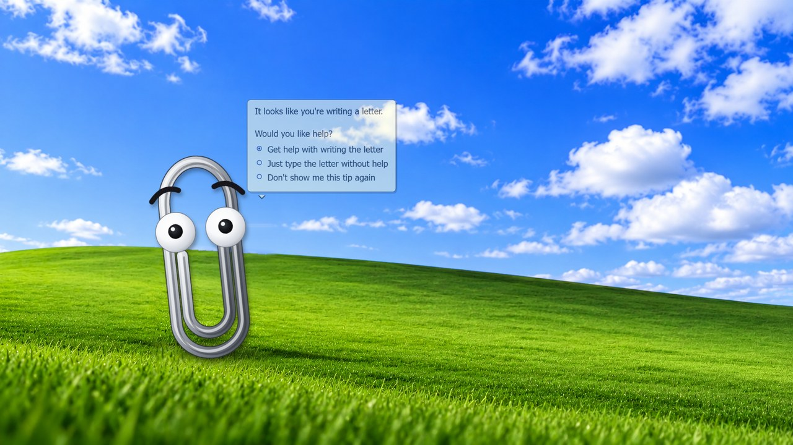
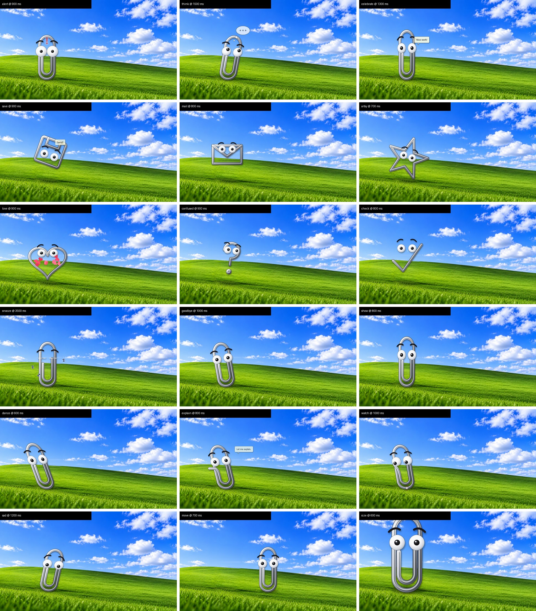

# Clippy OBS Virtual Background

**An animated Clippy for your stream.** A procedural, fully animated Clippy (the Microsoft Office
Assistant paperclip) standing on the Windows XP "Bliss" hill, rendered live by an OBS Studio
**Browser source**, plus a **click board** that makes him perform on command: the classic
*"It looks like you're writing a letter"* balloon, knocking on the glass, thinking, writing,
searching, saving, sending mail, celebrating with confetti, snoozing, the 6-7 meme, and more.

Works as a virtual background behind your camera (green screen or OBS background removal) or as a
transparent overlay on any scene. Drive it from the board, keyboard hotkeys, a Stream Deck, a phone
on your Wi-Fi, or any script that can open a URL.

## Features

- **No sprites, no video files.** Clippy is drawn as an SVG wire from point lists, so every part
  animates on its own (eyes, pupils, eyebrows, body squash and lean) and the whole clip can **morph**
  into other shapes the way the original did: magnifying glass, floppy disk, envelope, light bulb,
  heart, star, music note, atom, question mark, check mark, rope pile.
- **40+ actions** grouped as classic Clippy routines, reactions, idle bits, looks, positions and sizes.
- **Classic speech balloon** with the yellow box, pointer and blue bullet options. Type anything on the
  board, or use *"It looks like you're ..."* with your own activity.
- **Idles on his own** between actions: blinks, glances, sways, raises an eyebrow, taps, checks his
  watch, collapses into a coil, so the background is alive even when you ignore him.
- **Control board** page with keyboard shortcuts, usable in any browser or docked inside OBS.
- **URL triggers** (`/do/<action>`) for Stream Deck, Touch Portal, Loupedeck, OBS scripts, chat bots.
- **Transparent mode** for using Clippy as a stream overlay on top of your own background.
- **Optional synthesized sound effects** (boing, knock, pop, ding), off by default.
- Zero dependencies: a single Python 3 file serves everything; the pages are plain HTML and JavaScript.

## Quick start

Requirements: [OBS Studio](https://obsproject.com/) 30 or newer and Python 3 (Windows: the
`python` from the Microsoft Store is fine). Tested with OBS 33 on Windows 11; the pages are plain
web content so macOS and Linux should work the same with `python3 server.py`.

1. Download or clone this repo.
2. Run `start.cmd` (or `python server.py`). A console window stays open and the control board opens
   at `http://127.0.0.1:8787/`.
3. In OBS: **Sources > + > Browser**
   - URL `http://127.0.0.1:8787/background.html`
   - Width `1920`, Height `1080`, FPS `60` (or your canvas rate)
   - Tick **Control audio via OBS** only if you turn the sound effects on.
4. Put your **camera source above it**, with a **Chroma Key** filter (green screen) or the
   [OBS Background Removal](https://github.com/royshil/obs-backgroundremoval) plugin, so Clippy's hill
   shows behind you.
5. Click things on the board.

Optional, board inside OBS: **View > Docks > Custom Browser Docks**, name `Clippy`, URL
`http://127.0.0.1:8787/`.

## Driving Clippy

| Way | How |
| --- | --- |
| Board buttons | Every button fires immediately and interrupts whatever he was doing. |
| Keyboard | The small labels on the buttons are shortcuts while the board page is focused (`1` letter, `2` knock, `q` celebrate, `n` 6-7, `z` snooze, `h` goodbye, `j` come back, `Esc` stop). |
| Say something | Type in the box; lines starting with `- ` become the classic bullet options. |
| Any URL opener | `http://127.0.0.1:8787/do/greet`, `/do/celebrate`, `/do/say?text=Hello%20chat`, `/do/letter?activity=trying%20to%20beat%20this%20boss`, `/do/move?pos=right`, `/do/size?scale=1.5` |
| JSON | `POST /action` with `{"action": "greet"}` |
| Phone or tablet | Start with `python server.py --host 0.0.0.0` and open `http://<your-pc-ip>:8787/` on the device (same network, trusted networks only). |

Actions: `letter attention greet think writing search save mail explain artsy techy pile
celebrate alert idea confused check love laugh sad wink nod no dance rollEyes sixseven snooze wake
goodbye show lookAround browRaise sway tap watch look move size say hideBalloon stop setting bg`.

### URL options for the browser source

Append to `background.html`:

| Option | Effect |
| --- | --- |
| `?bg=0` | Transparent: Clippy only, for use as an overlay over your own background. |
| `?pos=left` `centerLeft` `center` `centerRight` `right`, or `?x=800` | Starting spot. |
| `?scale=1.4` | Starting size. |
| `?idle=0` | No automatic idle antics (the board toggle does the same). |
| `?sound=1` | Sound effects on from the start. |
| `?debug=1` | Shows the server link status in the corner. |

The page also works as a plain **Local file** browser source and still connects to the server when it
is running. Without the server it idles by itself.

## How it works

- `background.html` + `clippy.js`: the OBS page. A fixed 1920 x 1080 stage with the background image,
  an SVG Clippy built from two point lists (outer ring, inner wire) rendered with layered strokes for a
  chrome look, a tween engine, a particle system (confetti, hearts, sparkles, Zs) and the balloon.
  Morphing is point-to-point interpolation between shapes with the same point count.
- `board.html`: the control board. Sends JSON to the server, with BroadcastChannel and localStorage
  fallbacks when both pages are open in the same browser.
- `server.py`: a standard-library Python HTTP server that serves the files and relays actions to every
  connected background page over server-sent events. It remembers toggles, position and size so a
  reloaded source comes back the way you left it.
- `tools/clean_background.py`: rebuilds `assets/bliss_clean.png` from the source image by filling the
  sky from the neighbouring gradient and copying a horizon-aligned, brightness-matched patch of grass
  over the original character.
- `tools/snap.py`: renders frames of any action with headless Chrome for checking animations.

## Project layout

| File | Purpose |
| --- | --- |
| `start.cmd` | Double-click to start on Windows. |
| `server.py` | Local server and action relay (Python 3, no packages). |
| `background.html` | The OBS browser source. |
| `board.html` | The control board. |
| `clippy.js` | The character, shapes, actions, balloon, particles, sounds. |
| `assets/bliss_clean.png` | The hill without the baked-in character, 1920 x 1080. |
| `tools/` | Background cleanup and frame-rendering helpers. |

## Credits and legal

Clippy (Clippit) and the Office Assistant are Microsoft characters; this is an unofficial fan
recreation for fun, built from scratch with no Microsoft artwork, sprites or sounds. The hill is a
generated image in the style of the Bliss wallpaper. Not affiliated with or endorsed by Microsoft.

Code is MIT licensed, see `LICENSE`.

---

*Keywords: OBS Studio virtual background, animated stream overlay, Clippy, Clippit, Office Assistant,
Windows XP Bliss, Twitch, YouTube, Kick, browser source, stream deck, streaming, nostalgia, SVG animation.*
